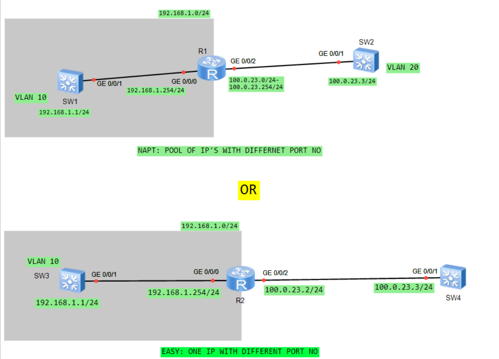

# Huawei eNSP NAT Implementation & Packet Analysis Lab

## Overview
This repository contains a hands-on network engineering lab built using **Huawei Enterprise Network Simulation Platform (eNSP)**. It demonstrates the design, CLI configuration, and packet-level verification of **NAPT (Network Address Port Translation)** and **Easy IP** on Huawei Enterprise Routers (AR Series) and Switches (S5700 Series).

The lab includes live ICMP packet captures via **Wireshark** to analyze how Layer 4 port multiplexing operates under both NAT modes.



---

## Network Topologies

The lab covers two distinct NAT implementation scenarios:


```

[ Top Topology — NAPT (Address Pool) ]
SW1 (VLANIF 10: 192.168.1.1/24) ───> GE0/0/0 [ R1 ] GE0/0/2 ───> GE0/0/1 (VLANIF 20: 100.0.23.3/24) SW2
(192.168.1.254)  (100.0.23.2)
NAT Pool: 100.1.23.1 - 100.1.23.254

[ Bottom Topology — Easy IP (Interface Translation) ]
SW3 (VLANIF 10: 192.168.1.1/24) ───> GE0/0/0 [ R2 ] GE0/0/2 ───> GE0/0/1 (VLANIF 20: 100.0.23.3/24) SW4
(192.168.1.254)  (100.0.23.2)
NAT Address: Outbound Interface IP (100.0.23.2)

```

---

## 1. NAPT Configuration (Address Pool)

NAPT maps multiple private IP addresses to a pool of public IP addresses, using unique TCP/UDP port numbers for session tracking.

### Device Configurations

#### **Switch SW1 (Private Switch)**
```text
system-view
sysname SW1
vlan 10
quit
interface GigabitEthernet 0/0/1
 port link-type access
 port default vlan 10
quit
interface Vlanif 10
 ip address 192.168.1.1 255.255.255.0
quit
ip route-static 0.0.0.0 0.0.0.0 192.168.1.254

```

#### **Router R1 (Gateway & NAPT)**

```text
system-view
sysname R1
interface GigabitEthernet 0/0/0
 ip address 192.168.1.254 255.255.255.0
quit
interface GigabitEthernet 0/0/2
 ip address 100.0.23.2 255.255.255.0
quit

# Configure NAT Address Pool & ACL Match Rule
nat address-group 1 100.1.23.1 100.1.23.254
acl 2000
 rule permit source 192.168.1.0 0.0.0.255
quit

# Bind NAPT outbound to Public Interface
interface GigabitEthernet 0/0/2
 nat outbound 2000 address-group 1
quit

# Default route to Public Network
ip route-static 0.0.0.0 0.0.0.0 100.0.23.3

```

#### **Switch SW2 (Public Switch)**

```text
system-view
sysname SW2
vlan 20
quit
interface GigabitEthernet 0/0/1
 port link-type access
 port default vlan 20
quit
interface Vlanif 20
 ip address 100.0.23.3 255.255.255.0
quit

# Static route back to the public NAT pool
ip route-static 100.1.23.0 255.255.255.0 100.0.23.2

```

---

## 2. Easy IP Configuration (Interface Translation)

Easy IP maps multiple private IP addresses directly to the single public IP address assigned to the router's egress interface (`100.0.23.2`), eliminating the need for a dedicated pool.

### Device Configurations

#### **Router R2 (Gateway & Easy IP)**

```text
system-view
sysname R2
interface GigabitEthernet 0/0/0
 ip address 192.168.1.254 255.255.255.0
quit
interface GigabitEthernet 0/0/2
 ip address 100.0.23.2 255.255.255.0
quit

acl 2000
 rule permit source 192.168.1.0 0.0.0.255
quit

# Bind Easy IP (No address-group parameter required)
interface GigabitEthernet 0/0/2
 nat outbound 2000
quit

ip route-static 0.0.0.0 0.0.0.0 100.0.23.3

```

*Note: In Easy IP mode, remote public switches (SW4) do **not** require a static return route, as the translated source IP (`100.0.23.2`) belongs directly to SW4's local subnet.*

---

## Verification & Session Analysis

### 1. NAPT Session Verification

Executing `display nat session all verbose` on **R1** confirms private source `192.168.1.1` translated to pool address `100.1.23.33`:

```text
Session Table Information:
  Protocol        : ICMP (1)
  SrcAddr  Vpn    : 192.168.1.1
  DestAddr Vpn    : 100.0.23.3
  NAT-Info
    New SrcAddr   : 100.1.23.33
    New DestAddr  : ----
    New IcmpId    : 10241

```

### 2. Easy IP Session Verification

Executing `display nat session all verbose` on **R2** confirms private source `192.168.1.1` translated directly to egress interface IP `100.0.23.2`:

```text
Session Table Information:
  Protocol        : ICMP (1)
  SrcAddr  Vpn    : 192.168.1.1
  DestAddr Vpn    : 100.0.23.3
  NAT-Info
    New SrcAddr   : 100.0.23.2
    New DestAddr  : ----
    New IcmpId    : 10245

```

---

## Key Takeaways & Comparison

| Parameter | NAPT Mode | Easy IP Mode |
| --- | --- | --- |
| **Public IP Pool** | Dedicated pool range (`nat address-group`) | Egress interface IP (`nat outbound <ACL>`) |
| **Return Route Requirement** | Required on public routers/switches | Not required |
| **Ideal Use Case** | Enterprise networks with allocated public IP blocks | Small Office / Home Office (SOHO) or dynamic IP (DHCP/PPPoE) links |

---

## 📬 Connect with Me

If you have any questions, feedback, or would like to discuss network engineering & cloud infrastructure, feel free to reach out!

[](https://www.linkedin.com/in/stephen-omololu)